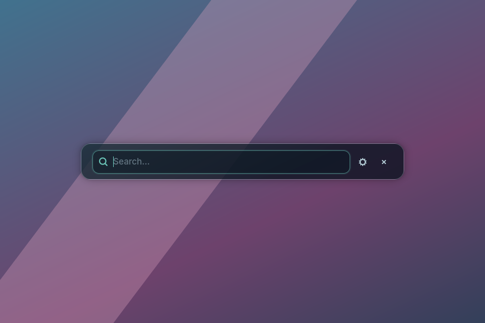
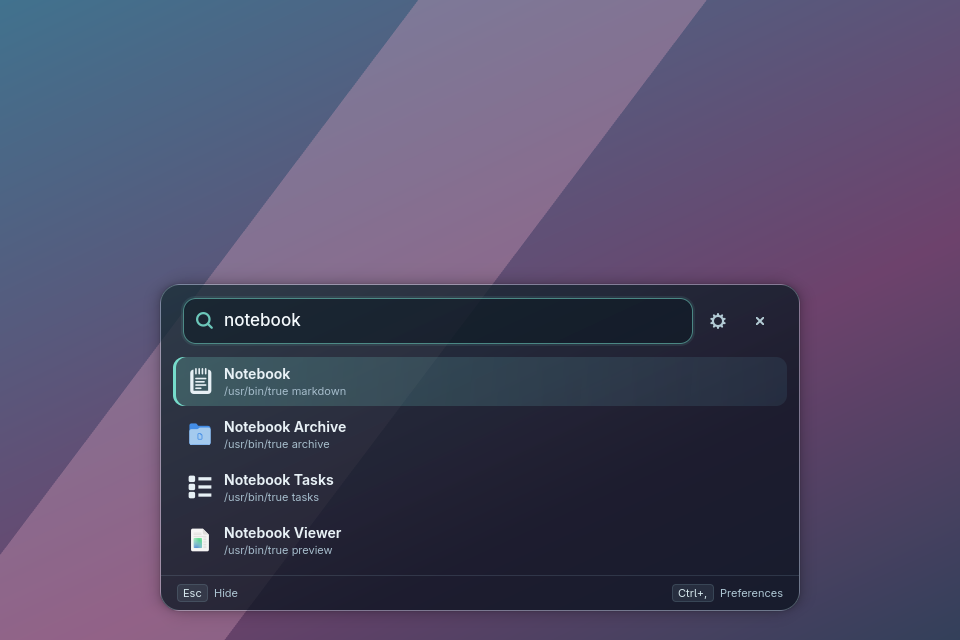

# DG Launcher

A GTK launcher for opening apps and files and running terminal commands. DG
starts as a single search bar and expands as results appear. AI is optional and
off by default.

| Search bar                                                                     | Search results                                                             |
| ------------------------------------------------------------------------------ | -------------------------------------------------------------------------- |
|  |  |

[DG 2.0 release notes and screenshots](https://github.com/sigmaSd/dg/releases/tag/v2.0.0)

## Installation

Download a build for Linux (x86-64), macOS (Apple Silicon or Intel), or Windows.
On Windows, extract `dg-windows.zip` and run `dg.exe` from the extracted folder.
The ZIP includes GTK and libadwaita.
[Downloads](https://github.com/sigmaSd/dg/releases/latest)

With [Deno](https://deno.com/), GTK 4, and libadwaita installed, you can install
DG globally:

```bash
deno install -gA --unstable-kv --unstable-worker-options jsr:@sigmasd/dg
```

Launch it with the `dg` command.

> **Tip**: For the best experience, add a global shortcut in your Desktop
> Environment (e.g., `Super+D`) to the `dg` command. Since the application stays
> in the background, it will appear instantly.

## Features

- **Extensible via TypeScript Plugins**: Enhance functionality by writing simple
  TypeScript plugins. Plugins run in a sandboxed worker environment for safety
  and stability.
- **Secure Permissions System**: Leveraging Deno's security model, plugins must
  explicitly request permissions (e.g., network access, file system). You have
  full control to grant or deny these requests.
- **Instant Access**: DG runs in the background, ensuring it appears instantly
  when you need it.
- **Built-in Tools**: Comes with an application launcher, calculator, Firefox
  history search, and a built-in plugin store to discover community extensions.
- **Appearance**: A translucent Glass theme with four colors and adjustable
  transparency, plus a System theme.
- **AI Assistant** (optional): Ask questions with OpenCode 2, choose a model,
  and enable web tools from Preferences.

## Getting Started

### Prerequisites

- [Deno](https://deno.com/)
- GTK 4 and libadwaita

### Running

To start the launcher:

```bash
deno task start
```

Use `Ctrl+Q` to quit the application completely, or `Escape` to hide it to the
background.

Press `Down` and `Up` (or `Ctrl+N` and `Ctrl+P`) to move through the results
while you keep typing, and `Enter` to open the highlighted one.

Open **Preferences → Appearance** to choose Glass or follow the system theme.
Glass comes in Ocean, Iris, Ember, and Graphite, with a transparency slider.
Changes preview in the launcher and Preferences. Choose **Save Appearance** to
keep them.

Open **Preferences → Plugins** from the gear icon or with `Ctrl+,` to turn
built-in or installed plugins on or off. Switches apply immediately. Turning a
plugin off keeps its settings and permission approvals.

Type `b <query>` to search Firefox history or `q <query>` to search the web. The
Plugins list shows the shortcuts. Open a plugin's **Settings** to change its
trigger. Use `Escape` to close Preferences.

### Opening local paths on Linux

Paste an absolute path or a path starting with `~/` into the search field. Use
`~` for your home folder. DG can open the path with its default app or reveal a
file in the file manager.

Open **Preferences** from the gear icon or press `Ctrl+,`, then choose **Paths**
under **Plugins**. Add installed apps such as Zed, choose whether each action
applies to files, folders, or both, and reorder or remove actions. Press
**Save** to apply the list. Enter runs the first action that applies to the
current path.

### Finding files and folders on Linux

Type `p <name>` to search your home folder and its subfolders. For example,
`p tax 2025` finds names containing both words in any order, regardless of case.
Use `p ~/Documents/ tax 2025` to search within a specific folder, and quote a
folder path if it contains spaces. Results show the parent folder and open with
the default app. Hidden files and folders are skipped.

**File Search** requires `fd` (also known as `fdfind`). DG disables the plugin
if it can't find the executable when it starts.

### Running terminal commands on Linux

Turn on **Terminal** in **Preferences → Plugins**, then try `!ls -la`. DG shows
the command before running it. Press **Enter** to open a terminal in your home
folder and run the command. The output stays visible after the command ends.
Press **Enter** in the terminal to close it. Quotes, pipes, and redirects work
as they do in your shell.

Open **Terminal → Settings** to choose an installed terminal or the system
default, change the shell executable, or customize the shortcut. The default `!`
goes directly before the command. A custom word shortcut is followed by a space.

## AI Assistant

AI Assistant is off by default. OpenCode 2 is only required for this optional
plugin. While a reply is in progress, the status bar shows activity such as
“Reading a web page…”.

### Prerequisites

1. **Install [OpenCode 2](https://opencode.ai/docs/)** for AI features. DG looks
   for the executable on your `PATH` and in `~/.opencode/bin`.

2. **Enable AI Assistant** in **Preferences → Plugins**. Its **Settings** page
   controls the trigger, OpenCode model, and tool access. Under **Tool Access**,
   turn on **Search the web (TinyFish)** or **Open web pages** as needed. You
   can also customize tool permissions in `~/.config/dg/plugins.json`:

   ```json
   {
     "opencode": {
       "tools": {
         "read": true,
         "grep": true,
         "glob": true
       }
     }
   }
   ```

   The `tools` section controls which AI capabilities are enabled:
   - `read`, `grep`, `glob` - **Enabled by default** (read-only operations)
   - `edit` and `write` share one OpenCode 2 permission. Enable both to allow
     file changes.
   - `bash`, `task` - **Disabled by default** (require explicit enable)
   - `websearch` enables search through TinyFish, and `webfetch` lets OpenCode
     read web pages. Both are off by default.
   - `external_directory` - Controls access outside DG's AI workspace

### Usage

1. Type `ai <your question>` and press Enter to get an AI response. Type a
   follow-up and press Enter to continue the conversation. `Up` and `Down`
   scroll it.

2. **Include clipboard context**: Use `$clipboard` or `$cb` in your query to
   include the current clipboard content in the AI's context:

   ```
   ai explain this $clipboard
   ```

3. **Switch models**: Open **Preferences → Plugins → AI Assistant → Settings**
   to see OpenCode's default and browse available models. When AI Assistant is
   enabled, `Ctrl+M` opens the launcher model picker and `Ctrl+Shift+M` filters
   it to models with zero listed cost. Choose **Use OpenCode default** or leave
   the model field blank to use OpenCode's default model.

## Plugin Development

Plugins are TypeScript modules that implement the `WorkerPlugin` interface. They
run in a separate worker thread and can be easily shared by publishing a package
to [JSR](https://jsr.io).

To make your plugin discoverable in the built-in store, ensure your JSR package
lists `@sigmasd/dg` as a dependency in your `deno.json`. The store uses the JSR
Dependents API to find all compatible plugins.

Example structure:

```typescript
import { WorkerPlugin } from "jsr:@sigmasd/dg/worker/client";
import type { PluginMetadata, SearchResult } from "jsr:@sigmasd/dg/interface";

export const meta: PluginMetadata = {
  id: "my-plugin",
  name: "My Plugin",
  description: "Does something cool",
  trigger: "cool", // Optional: Type 'cool <query>' to trigger (requires a space after)
};

export default class MyPlugin extends WorkerPlugin {
  async search(query: string): Promise<SearchResult[]> {
    return [{
      title: "Hello World",
      subtitle: `You typed: ${query}`,
      score: 100,
      onActivate: () => console.log("Activated!"),
    }];
  }
}
```

## Preparing a release

Run these checks from the repository root before publishing.

```sh
deno outdated --frozen
deno audit --frozen
```

Review available updates and security advisories. After changing dependencies,
rerun `deno test --frozen test/` and commit the updated `deno.lock`.

Commit release screenshots under `distro/` and embed them in the release notes
using raw GitHub URLs pinned to the commit that contains the images. Keep the
release assets list for downloadable builds.
